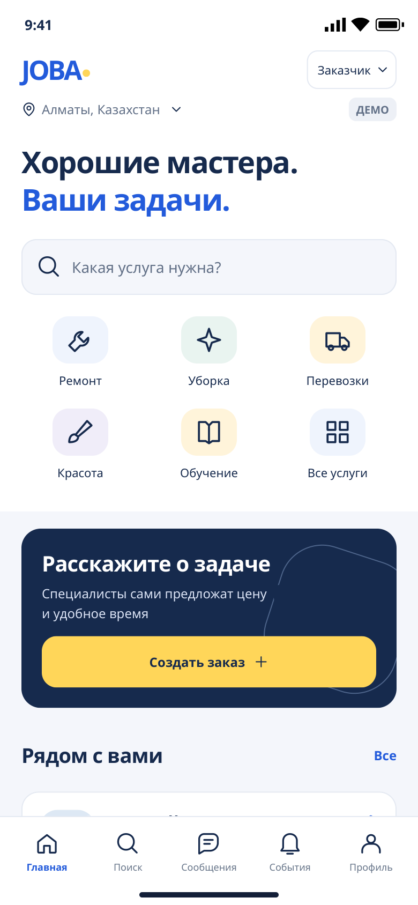
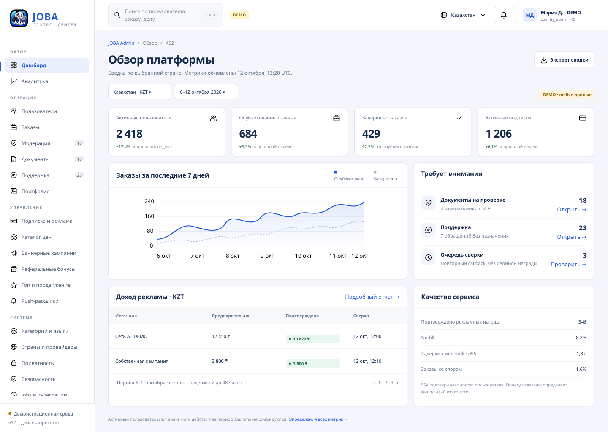
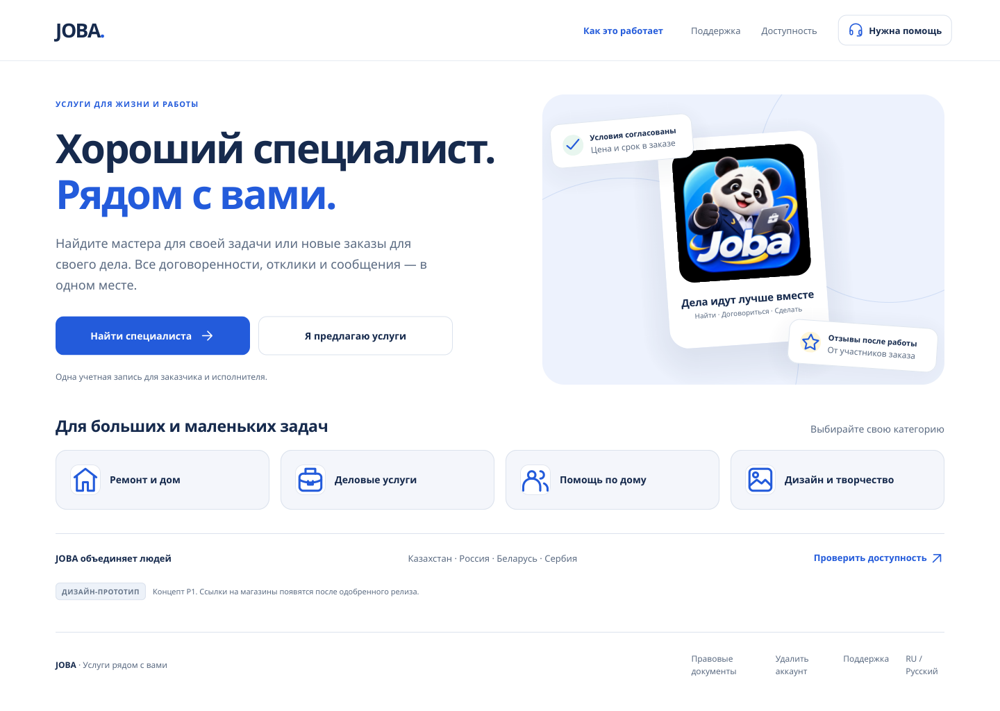

# JOBA — макеты и дизайн-материалы

Материалы к [ТЗ JOBA v1.1 от 12 октября 2026 года](../spec/services-marketplace-spec-v1.ru.md). Названия файлов ТЗ сохранены для совместимости; внутри документов указана редакция 1.1.

## Скачать и посмотреть

| Материал | PDF для просмотра | Полный пакет |
|---|---|---|
| Мобильное приложение: 42 основных экрана | [42 экрана](pdf/JOBA_Mobile_42_screens.pdf) | [JOBA_Mobile_Prototype.zip](packages/JOBA_Mobile_Prototype.zip) |
| Административная панель: 22 основных экрана | [22 экрана](pdf/JOBA_Admin_22_screens.pdf) | [JOBA_Admin_Web_Prototype.zip](packages/JOBA_Admin_Web_Prototype.zip) |
| Публичный сайт: 5 страниц | [5 страниц](pdf/JOBA_Public_5_screens.pdf) | В том же Admin Web Prototype |
| Полные вертикальные изображения mobile | — | [JOBA_Mobile_Full_Screens.zip](packages/JOBA_Mobile_Full_Screens.zip) |
| Полные вертикальные изображения admin и public | — | [JOBA_Admin_Full_Screens.zip](packages/JOBA_Admin_Full_Screens.zip) |

На странице файла в GitHub выберите Download raw file / Download, если встроенный просмотр недоступен. Четыре ZIP самостоятельные: их не нужно объединять или склеивать.

## Открыть макеты локально

1. Скачайте нужный ZIP и распакуйте его целиком, сохранив структуру.
2. Откройте index.html в корне распакованной папки:
   - JOBA_Mobile_Prototype/index.html — обзор; mobile/index.html — демонстрационный мобильный прототип.
   - JOBA_Admin_Web_Prototype/index.html — обзор; admin/index.html — админ-панель; public/index.html — публичные страницы.
   - JOBA_Mobile_Full_Screens/index.html — галерея 42 полных мобильных PNG.
   - JOBA_Admin_Full_Screens/index.html — галерея полных PNG.
3. Для просмотра не нужны сборка, сервер, установка зависимостей или другие архивы. HTML нужно открывать после скачивания: GitHub показывает его исходный текст.
4. Для передачи в разработку используйте HANDOFF_RU.md, SCREEN_MAP.md, screen_manifest.json, design_tokens.json и DESIGN_SYSTEM.md внутри соответствующего пакета.

Мобильный прототип содержит 115 PNG отдельных экранов и состояний. Самостоятельный Mobile Full Screens содержит 42 полных PNG (157 мобильных PNG всего). Admin Web Prototype содержит 81 PNG, включая дополнительные состояния и адаптивные примеры. Admin Full Screens содержит 71 полный admin PNG и 5 полных public PNG. PDF показывают основные экраны, дополнительные состояния находятся в ZIP.

## Быстрый обзор

### Мобильное приложение

### Административная панель

### Публичный сайт

## Статус и ограничения

Это дизайн-артефакты и демонстрационные HTML/JS-прототипы. Данные, цены, сроки, правовые версии и статусы стран демонстрационные. Реальные регистрации, платежи и отправки не выполняются. Не вводите настоящие пароли, документы или платежные данные.

PNG и PDF получены статическим рендером; browser/device end-to-end QA не проводилась. Пакет не подтверждает готовность production-приложения. Точные ограничения и параметры передачи сохранены в документах пакетов.

Исходный логотип, изображения и лицензии локальных шрифтов Noto Sans сохранены. Лицензии шрифтов находятся рядом со шрифтами внутри ZIP; их нужно сохранять при дальнейшем распространении.

Мобильные макеты разделены на прототип и галерею полных экранов; объединять архивы не требуется. Изображения, шрифты и лицензии сохранены без изменений; file_manifest.json каждого ZIP содержит контрольные суммы его файлов. [SHA-256 опубликованных файлов](SHA256SUMS.txt).
